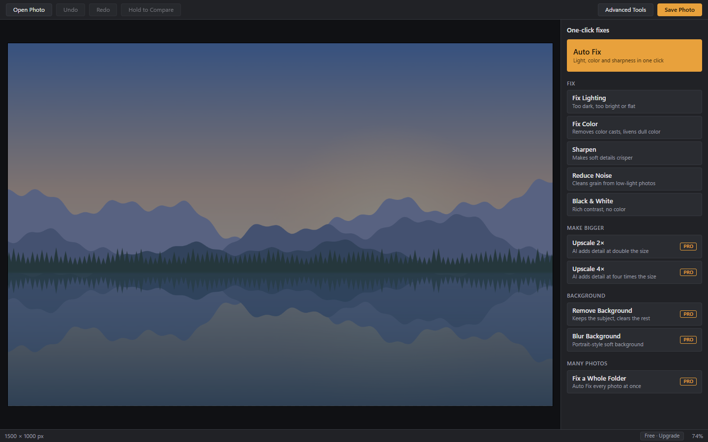
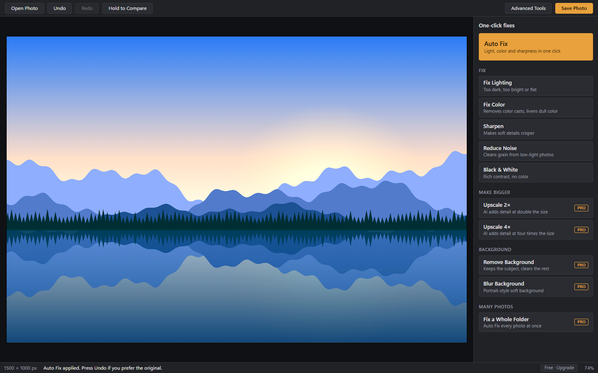
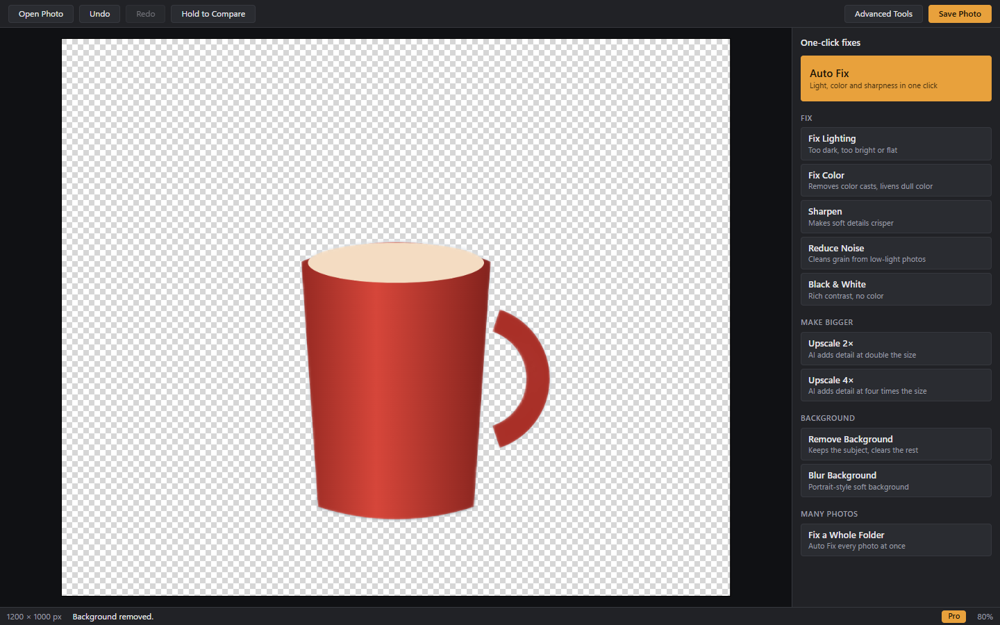
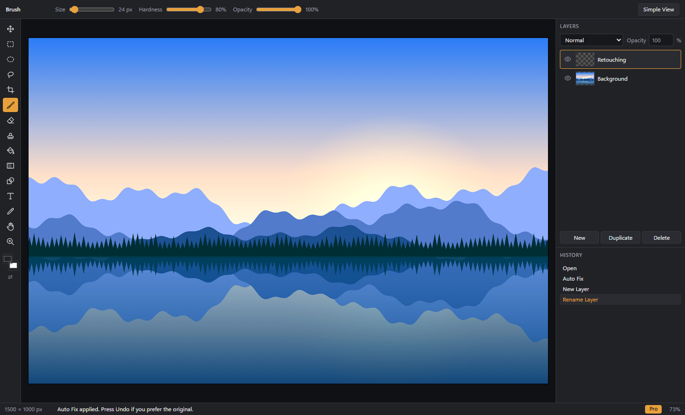

# Facet

### Your photos. Their best light.

One-click photo fixes for Windows, by **Prosper Technologies**.
Fix light, color and sharpness while your photos stay on your PC.

[**Download for Windows**](https://github.com/ProsperTechnology/facet/releases/latest) · [**Visit the website**](https://prospertechnology.github.io/facet/) · [**Facet Pro**](https://prospertechnology.gumroad.com/l/facet-pro)

 

## A few clicks. A better photo.

1. **Open a photo.** Drop it into Facet or choose a file from your PC.
2. **Find its best light.** Start with Auto Fix, or choose a lighting, color or detail fix. Hold Compare to see the original.
3. **Save your edit.** Facet suggests a new file name to help preserve your original.

## Choose your tools

| Facet · Free | Facet Pro · $1.99/month |
| --- | --- |
| Auto Fix, Fix Lighting and Fix Color | Everything in Facet, plus: |
| Sharpen, Reduce Noise and Black & White | AI upscaling at 2× and 4× |
| Layers, brushes, selections and crop | Background removal and blur |
| No watermarks | Batch folder fixes and PSD support |

Pro subscriptions and license keys are handled by [Gumroad](https://prospertechnology.gumroad.com/l/facet-pro).

## See Facet in action

App screenshots using sample illustrations:

### Before Auto Fix

### After Auto Fix

### Background removal · Pro

### Room to go further

## Download & install

Get the Windows installer from [the latest release](https://github.com/ProsperTechnology/facet/releases/latest). Facet supports **Windows 10 and Windows 11**. No account is needed for free editing.

The installer is not code-signed yet, so Windows SmartScreen may display a warning. Verify that your installer came from this repository's official releases before deciding whether to proceed.

## Your photos stay with you

Editing, including AI tools, happens on your PC. Pro activation sends your license key and product ID to Gumroad to check membership. Read the [privacy policy](https://prospertechnology.github.io/facet/privacy.html) for details.

## Help & feedback

[Open an issue](https://github.com/ProsperTechnology/facet/issues) to report a problem or suggest an improvement. Include your Windows version and steps to reproduce the issue. Issues are public; keep license keys and personal information private.

## About this repository

This repository contains Facet's **GitHub Pages website and installer releases**. The application's source code is not published here.

The website uses plain HTML and CSS, with no build step. GitHub Pages publishes from the root of `main`.

**Prosper Technologies** · [Website](https://prospertechnology.github.io/facet/) · [Releases](https://github.com/ProsperTechnology/facet/releases)
